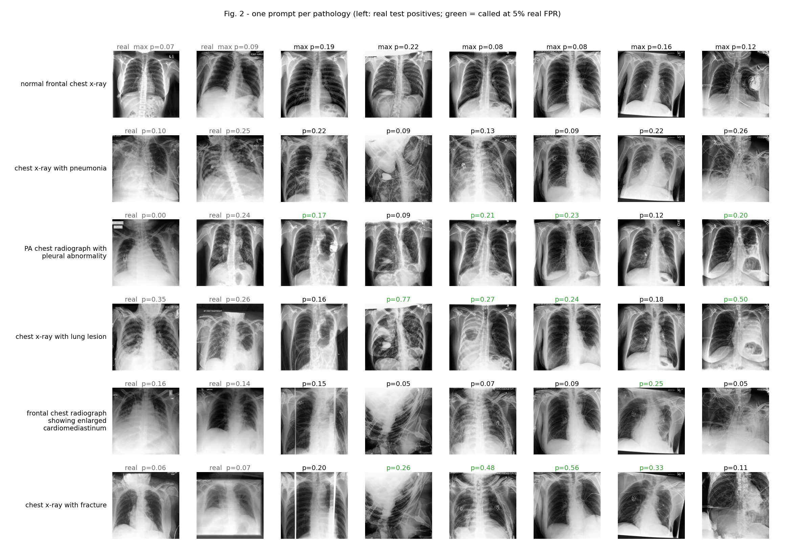
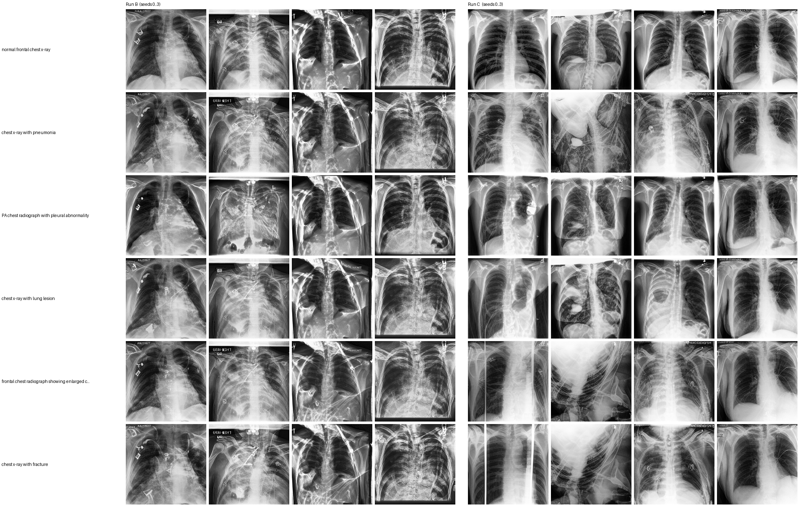
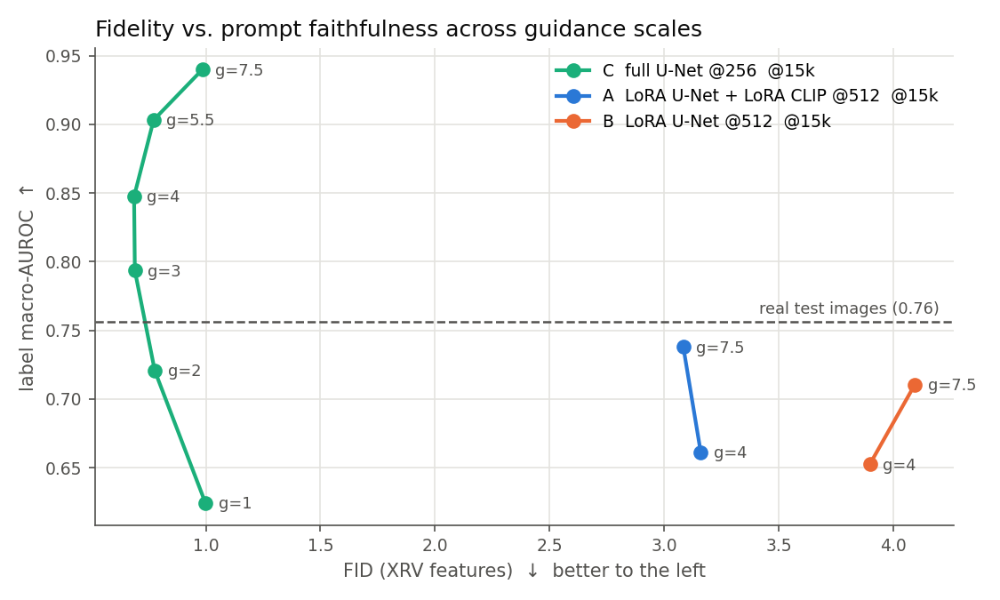
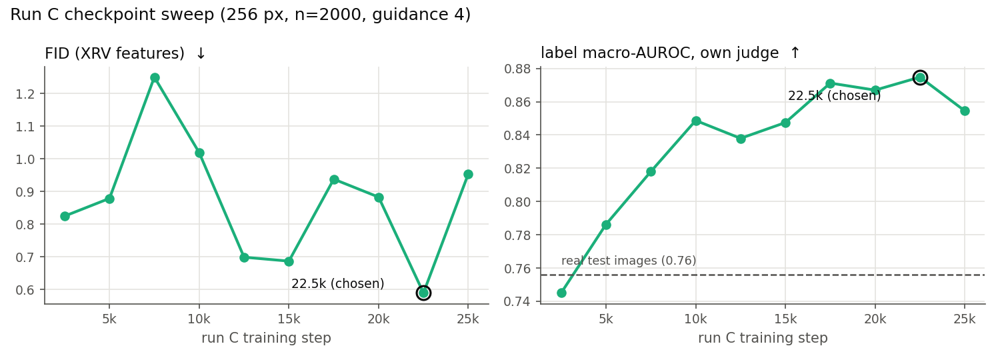
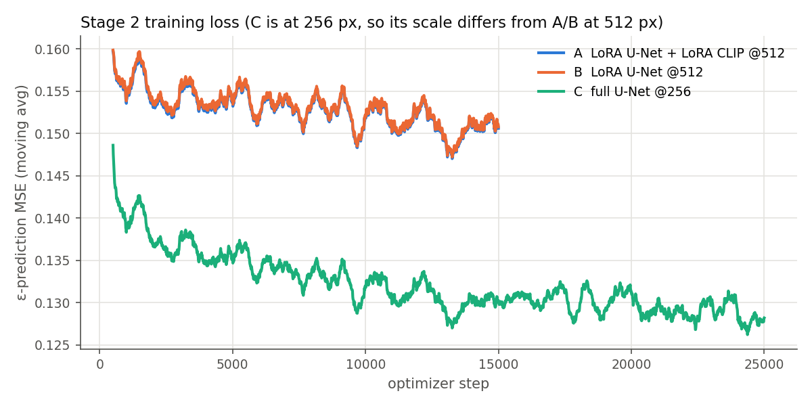
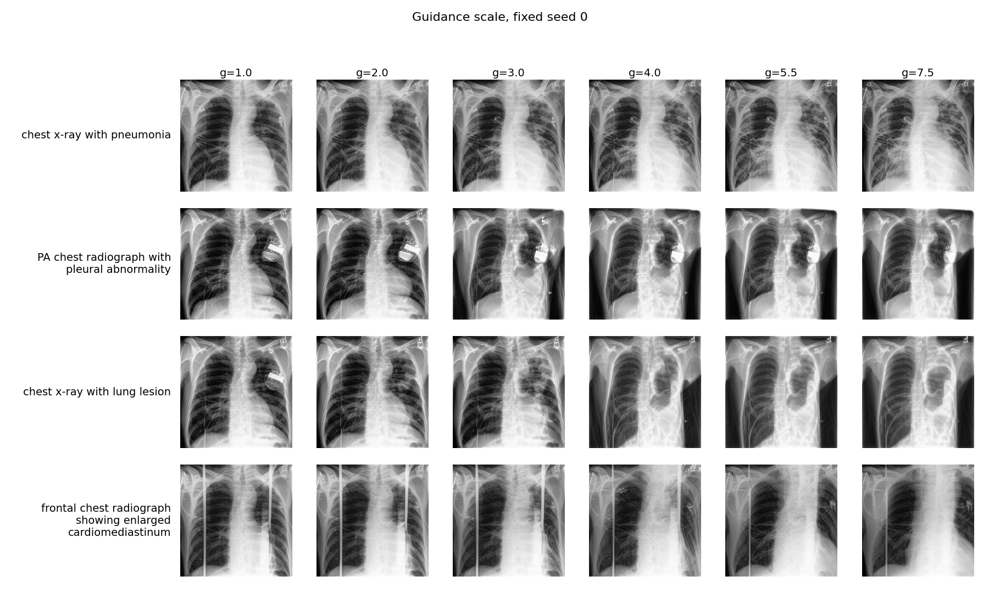
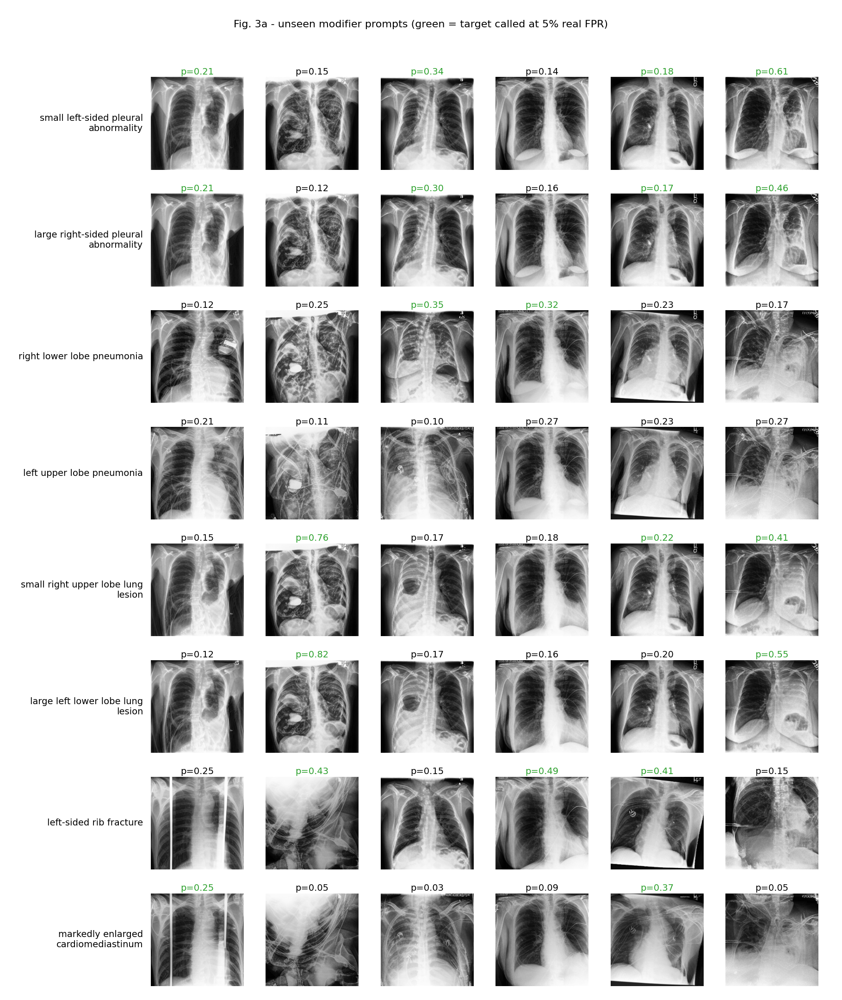
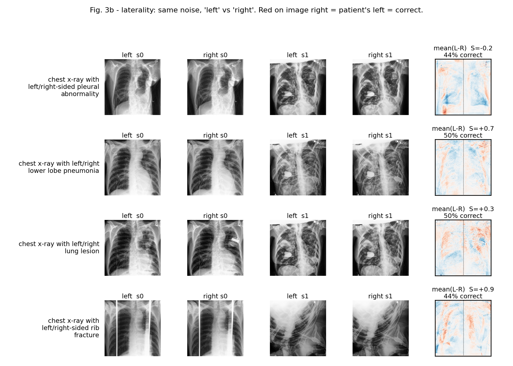
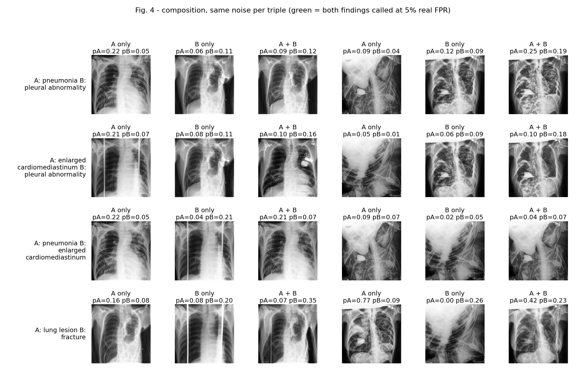

# RoentGen on CheXpert — text-conditioned chest X-ray generation

IE643 course project (Team NeuroSight). This is a reimplementation of
*A vision–language foundation model for the generation of realistic chest X-ray images*
(Bluethgen et al., Nat. BME 2025, "RoentGen"), scaled down to one RTX 4070 (12 GB) and the public
**CheXpert-v1.0-small** dataset.

We fine-tune Stable Diffusion 1.4 to generate chest X-rays conditioned on five pathologies:
**Pleural Other, Pneumonia, Lung Lesion, Fracture, Enlarged Cardiomediastinum**. We then evaluate
the images for fidelity, diversity and prompt faithfulness. The final step tests whether synthetic
images help a downstream classifier.

> **Research question:** does Real + Synthetic training beat Real-only for these five pathologies?

<p align="center">
  <br>
  <sub>One prompt per pathology. The two left columns are real CheXpert test positives; the rest are synthetic
  (run C, 16 seeds per prompt, 6 shown). <i>p</i> is our judge classifier's probability for the prompted finding. Green means the finding is
  "called" at a 5% false-positive rate calibrated on real images.</sub>
</p>

---

## Headline results

| | |
|---|---|
| **Primary model** | Run **C**: full U-Net fine-tune at 256 px, checkpoint **15k**, guidance **4.0** |
| **Fidelity** | FID<sub>XRV</sub> **0.67** (untrained SD 1.4: 19.35; real-vs-real floor: 0.11) |
| **Prompt faithfulness** | label macro-AUROC **0.844** with our DenseNet judge (real test images score 0.756) |
| **Diversity** | intra-prompt MS-SSIM 0.22 (random real pairs: 0.34) |
| **Status** | Stages 1, 2 and 4 are done. Stage 3 (synthetic twins for the Stage 5 subsets) is generating; the Stage 5 grid runs right after. |

### Model comparison (256 px, n = 2000 prompts taken from real test rows, DPM++ 25 steps, guidance 4)

| Set | FID<sub>XRV</sub> ↓ | FID<sub>Inception</sub> ↓ | MS-SSIM | Label macro-AUROC (own judge) ↑ |
|---|---|---|---|---|
| real test images | 0.11 | 11.1 | 0.34 (random pairs) | 0.756 |
| SD 1.4, no fine-tuning | 19.35 | 193.1 | 0.088 | 0.514 |
| A: LoRA U-Net + LoRA CLIP @512, 15k | 3.16 | 46.3 | 0.128 | 0.661 |
| B: LoRA U-Net @512, 15k | 3.90 | 41.5 | 0.139 | 0.652 |
| **C: full U-Net @256, 15k (primary)** | **0.67** | 33.0 | 0.221 | **0.844** |
| C: full U-Net @256, 22.5k | 0.59 | 30.9 | 0.232 | 0.875 |

Every number comes from a JSON file in [`results/`](results/) (`fidelity_*`, `classify_*`, `clip_*`).
The C@15k row is a fresh retrain of run C with the same seed and hyperparameters. The first C@15k run scored
0.69 / 31.2 / 0.220 / 0.847, so training reproduces to within sampling noise.
The full tables, including every sweep, are in [`docs/STATUS.md`](docs/STATUS.md).

---

## Key findings

### 1. LoRA runs barely follow the prompt; the full U-Net fine-tune does

<p align="center">
  <br>
  <sub>Same prompts (rows) and the same initial noise (columns) for run B (left) and run C (right). For B, each seed produces nearly the same
  image whatever the prompt. C changes the image to match the prompt.</sub>
</p>

A and B learn the look of a chest X-ray (FID drops from 19 to about 3), but the prompt has little effect on the output.
The text-encoder LoRA in A did train (its weights moved), so this is not a loading bug. Even at guidance 7.5, A and B
stay below C at guidance 2 on label AUROC. **C is the primary run.**

### 2. Guidance trades fidelity for label strength; checkpoints past 12.5k are within noise

<p align="center">
  
</p>

Label AUROC rises steadily with guidance (0.62 → 0.94). FID<sub>XRV</sub> is U-shaped, with its minimum at g ≈ 3–4.
We use **g = 4** for the best fidelity. g = 5.5 is an option if Stage 5 needs stronger labels.

<p align="center">
  
</p>

C was extended from 15k to 25k steps. 22.5k scores slightly better than 15k (FID<sub>XRV</sub> 0.59 vs 0.69, AUROC 0.875 vs 0.847)
and 25k regresses. But FID<sub>XRV</sub> moves by up to about 0.35 between neighbouring checkpoints (single sampling seed), so 15k and 22.5k
are within noise of each other. We use **C@15k**: it is the checkpoint behind every Stage 4 analysis (guidance sweep, BiomedCLIP,
qualitative probes and the real-vs-synthetic diagnosis), so Stages 3–5 use the same model that was characterised.

<details>
<summary>Training loss curves</summary>
<p align="center"></p>
</details>

### 3. Synthetic images score *above* real ones, because their labels are cleaner (not memorisation)

C@15k reaches label AUROC 0.85 against 0.76 on real test images (paired bootstrap Δ = +0.092, 95% CI [0.067, 0.117]).
The diagnosis ([`diag_c_vs_real.py`](src/roentgen/diag_c_vs_real.py)) rules out uncertain labels, judge overfitting
and memorisation: nearest-neighbour similarity to the training set is *lower* for synthetic images than for real test images.
The cause is **label–image consistency**. A synthetic image is rendered from its label text alone, so it shows the
learned prototype of that label. Real images carry label noise and unlabelled confounders. Real AUROC is a
reference, not a ceiling.

### 4. Qualitative probes (paper Figs. 2–4)

| Probe | Result |
|---|---|
| Pathology prompts | Works. Called rates are comparable to real positives; the normal prompt has a 3.7% any-finding rate (< 5% FPR) |
| Unseen modifiers ("small", "large", …) | The finding still appears, but size words have no visible effect |
| Laterality ("left" vs "right") | No effect. Our templated prompts never contain laterality (a data limitation) |
| Composition ("A and B") | Weak. Both findings are diluted and are both called in only 0–6% of seeds |

<details>
<summary>Guidance, modifier, laterality and composition figures</summary>





</details>

### 5. Evaluation tooling notes
- The pretrained **TorchXRayVision** classifier is near chance on these five labels, even on *real* images (macro AUROC 0.55).
  So the judge is our own DenseNet-121 trained on the real train split (test macro AUROC 0.749).
- **BiomedCLIP** (an open substitute for the paper's MIMIC-only metrics) reads CXR labels only weakly, even on real images
  (zero-shot 0.34 vs chance 0.17). Its ordering agrees with the judge (SD ≈ A < B < real ≲ C).

---

## Pipeline and current status

| Stage | What | Status |
|---|---|---|
| 1 | CheXpert manifest, patient-level splits (152k / 20k / 19k), label → prompt templates, VAE latent cache | ✅ |
| 2 | Fine-tune SD 1.4: runs A, B (LoRA @512, 15k steps), C (full U-Net @256, 25k steps) | ✅ |
| 4 | Fidelity (FID, MS-SSIM), label AUROC, BiomedCLIP retrieval, qualitative figures, guidance and checkpoint sweeps | ✅ |
| 3 | Synthetic twin (same labels, per-row seed) of every real train row in the Stage 5 1% and 10% subsets: 44,603 images with C@15k, DPM++ 25 steps, g = 4 | 🟡 generating (`artifacts/synth/C_step15000_g4.0_dpm25`); sampler check (PNDM-75 vs DPM++-25) done, DPM++ kept |
| 3b | `filtering.py`: drop degenerate images; judge-score rejection rate per pathology | 🟡 code done, runs on the new corpus after Stage 3 |
| 5 | DenseNet-121 trained on Real vs Synth vs Mixed × {1%, 10%} × 3 seeds (paper Ext. Data Fig. 2); Real 100% is the judge | 🟡 queued after 3b (`artifacts/logs/queue_15k.sh`) |
| 6 | Results aggregation and Gradio demo (prompt → synthetic CXR) | ⬜ |

### Next steps
1. Finish Stage 3 twins and run `filtering.py` on them (rejection rate per pathology measures how often conditioning fails).
2. **Stage 5**: Real / Synth / Mixed grid at 1% and 10% (3 seeds each), summarised by `python -m roentgen.stage5_table`
   into `results/stage5.json`. The low-data regime is where the paper reports synthetic data helping most.
3. `aggregate.py` for the final tables and AUROC-vs-data-size curves; Gradio demo.

---

## Repository layout

```
src/roentgen/        all pipeline code (one module per stage; see docs/CODE_MAP.md)
results/             every metric as JSON (fidelity_*, classify_*, clip_*, qual_*, diag_*)
artifacts/figures/   comparison sheets and qualitative figures
artifacts/runs/*/    training args + loss logs (log.jsonl) for runs A, B, C
artifacts/cls/       judge classifier result + log
artifacts/logs/      queue_*.sh: the exact command batches behind each result
docs/                PLAN.md (design), STATUS.md (live log + full tables), CODE_MAP.md (file guide), img/
```

Not in the repo (too large, or covered by the data licence): the CheXpert images (`data/`), latent caches,
model checkpoints (~50 GB) and generated image sets.

## Reproducing

```bash
uv venv --python 3.10 .venv && source env.sh
uv pip install -r requirements.txt --extra-index-url https://download.pytorch.org/whl/cu124 --index-strategy unsafe-best-match
# put CheXpert-v1.0-small under data/

python -m roentgen.chexpert --build                 # Stage 1: manifest + splits
python -m roentgen.cache_latents --size 256         # Stage 1b: latent cache
python -m roentgen.train_lora --run C --steps 15000 # Stage 2
python -m roentgen.train_classifier --cache && python -m roentgen.train_classifier --frac 1.0 --seed 0   # judge
python -m roentgen.eval_fidelity --run C --step 15000 --size 256   # Stage 4a
python -m roentgen.eval_classify --tag C_step15000                 # Stage 4b
python -m roentgen.generate --step 15000 --limit 44603             # Stage 3 (1% + 10% subsets)
python -m roentgen.filtering --synth artifacts/synth/C_step15000_g4.0_dpm25   # Stage 3b
bash artifacts/logs/queue_15k.sh                                   # or the whole Stage 3 -> 5 chain
python -m roentgen.readme_figures                                  # charts in this README
```

Each module's docstring lists its options; [`docs/CODE_MAP.md`](docs/CODE_MAP.md) describes every file.

## Data

[CheXpert](https://stanfordmlgroup.github.io/competitions/chexpert/) (Irvin et al., 2019) is used under the Stanford
research use agreement. Some figures include real CheXpert test images next to the synthetic ones for comparison.
